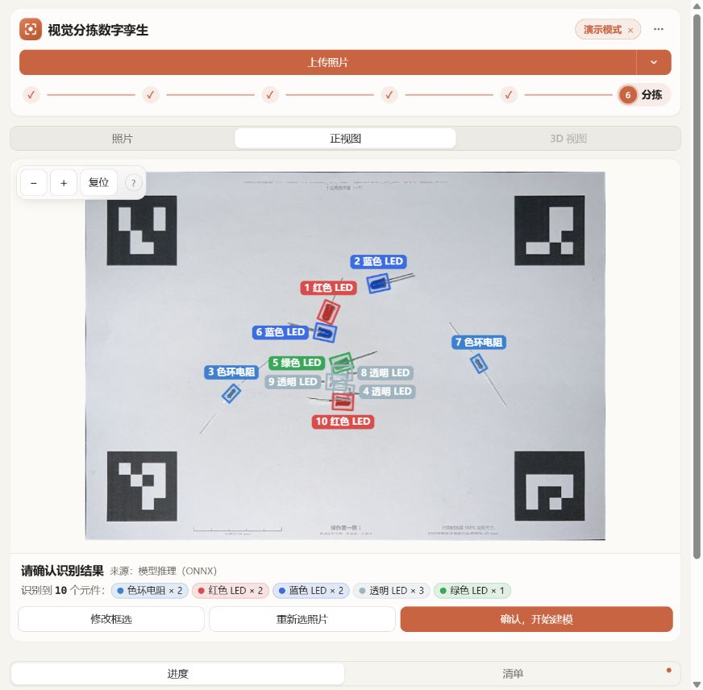
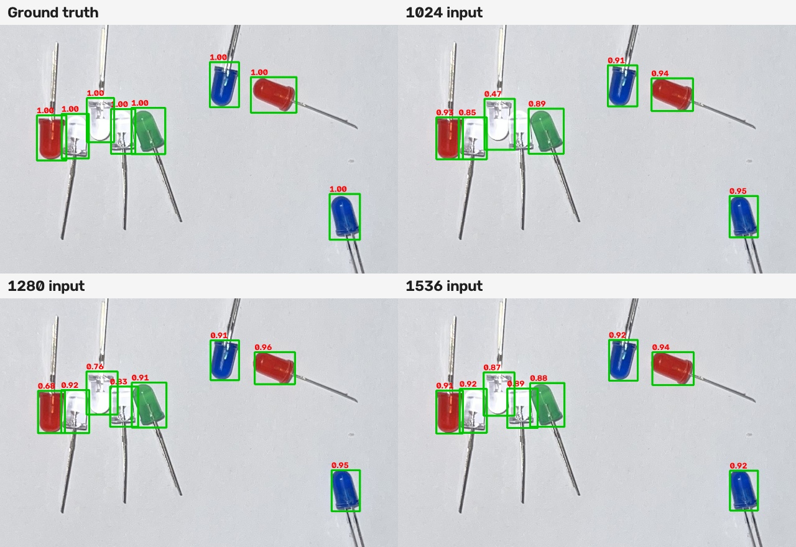
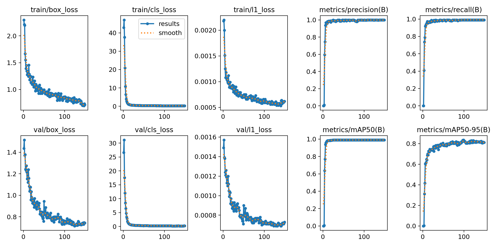
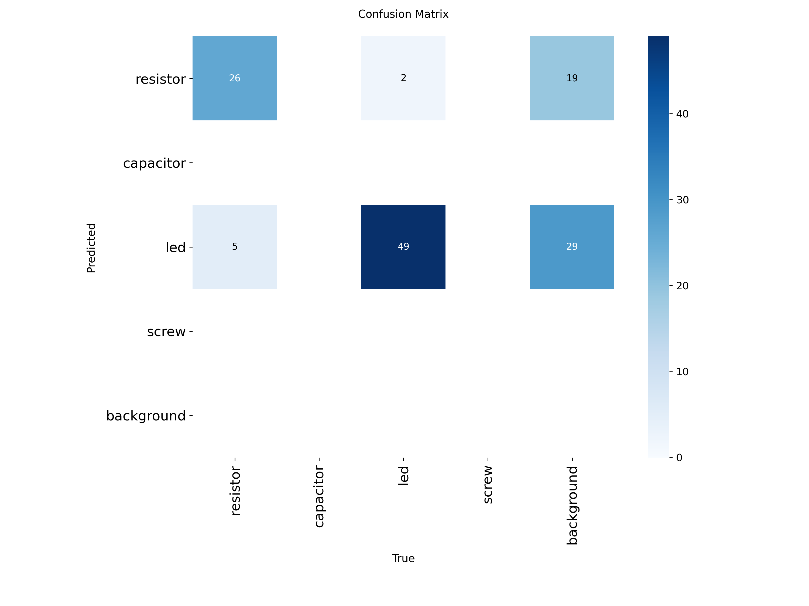

# 步骤 13 训练报告：零件检测模型（YOLO26n）与相机标定

仓库里的 `public/models/best.onnx` 当前采用 **11 月 17 日光照增强版的最佳权重、1280 输入**。11 月 18 日针对 IMG_9902 做了分辨率对照及三组微调，最终选择保留表现更稳的原权重，提高输入分辨率。最新结果在第 0 节，之后的 1024 接入记录和第 1–6 节均为历史数据。

## 0. IMG_9902 密集透明 LED 调优与当前配置（2026-11-18）

IMG_9902 有 2 个电阻、8 个 LED，其中 3 个透明 LED 紧邻有色 LED。原 1024 模型漏掉靠绿色 LED 的透明灯体，模型分数约 0.064；另一个透明灯体的边界也会随 JPEG 解码略变。这是小目标缩图后的细节不足，不能靠降低置信度阈值可靠解决。

### 最终选择

- 权重仍为 `runs/detect/light/weights/best.pt`（原光照增强训练的第 74 轮），重新导出为固定输入 `[1,3,1280,1280]`、输出 `[1,300,6]` 的 ONNX，opset 18、float32、`nms=False`。
- `src/config.js` 的默认输入同步为 1280；置信度 0.4、低档补漏 0.25、同类去重 0.7、低档最大重叠 0.3 均保持不变。Worker 读取模型实际尺寸，评估脚本也改为按模型输入形状处理。
- IMG_9902 检出 10/10、误检 0，三颗透明 LED 分数约 0.83 / 0.76 / 0.92。网页颜色结果为电阻 2、红 LED 2、蓝 LED 2、绿 LED 1、透明 LED 3。
- 三张内置实拍参考检测重新生成，IMG_9899 / IMG_9901 / IMG_9902 均为 10 个框；单线程 WASM 与人工真值逐一匹配，三图均无漏检或多框。
- 生产网页的 IMG_9902 完整流程也已跑通：10 个元件全部入盒、拨开 4 次，控制台无错误。桌面与手机宽度浏览器回归各 5 组通过，离线包已同步。



| 配置（同一原权重） | 17 张原图检出/标注 | 原图误检 | IMG_9902 | 8 条件透明 LED 召回 | 8 条件全部误检 |
| --- | --- | --- | --- | --- | --- |
| 1024（上一默认） | 121/124 | 0 | 9/10 | 248/296（83.8%） | 7 |
| **1280（当前默认）** | **123/124** | **0** | **10/10** | **269/296（90.9%）** | 12 |
| 1536 | 124/124 | 0 | 10/10 | 273/296（92.2%） | 24 |

1280 在八种条件下合计检出 962/992，电阻 221/224、有色 LED 472/472；1024 为 941/992。上表误检是**未经过板面工作区过滤的模型输出**，包含纸外键盘、边缘等候选；原图之外的合成光照下并非所有类别都改善。1536 虽然原图全检出，但模拟光照下电阻召回更低、误检更多，且 WASM 更慢，因此不作为默认。

单线程 WASM 的 IMG_9902 数值基准（jpeg-js 解码、一轮预热后平均三次）中，1024 约 0.45 s、1280 约 0.88–1.06 s、1536 约 1.74 s，仅为模型推理时间。机器负载和浏览器不同会影响耗时。对照记录为 `runs/dense_tuning/baseline_sizes.json`、`baseline_1280_all.json`、`baseline_1536_all.json`、`web_final_benchmark.json`。当前部署图与已评估的 1280 图逐字节相同（比较 ONNX graph，忽略导出日期等 metadata）。



### 数据增强与实际训练试验

`prepare_dense.py` 仅用原训练集 150 张照片制作 450 个样本：150 张整图、150 张近景裁剪、150 张透明/有色 LED 密集混排粘贴。来源池为 362 个零件团，其中 38 个含透明 LED，通过抽样权重平衡透明与有色来源。生成框共 811 个电阻、2047 个 LED。裁剪不截断已标注本体，粘贴不压定位码和现有本体。验证、测试的 68 个图片/标签文件与原划分哈希一致，训练父照片与验证/测试无交集，**没有把 IMG_9902 放入训练**。

`train_dense.py` 从原最佳权重微调，降低 HSV 扰动，去掉强模糊，采用较轻的曝光/阴影/色温增强；`nms=False` 让最佳轮次按网页实际使用的一对一检测头验证选择。以下是实际运行结果，不是仅拟定配置：

| 运行名 | 数据与参数 | 实际轮数 / 计划 | 最佳验证轮次 | 最佳验证 mAP50–95 |
| --- | --- | --- | --- | --- |
| `dense_control_1024_w1` | 原增强集 300 张；1024；lr 0.00035；mosaic 0.2、scale 0.2 | 26 / 40，回归退步后主动停止 | 23 | 0.8061 |
| `dense_mixed_1024` | 新增强集 450 张；1024；lr 0.00035；mosaic 0.2、scale 0.2，降低 bias warmup | 27 / 50，回归退步后主动停止 | 17 | 0.8180 |
| `dense_native_1280` | 整图+混排共 300 张，排除近景裁剪；1280；lr 0.0001；mosaic 0、scale 0.1、旋转 ±5° | 40 / 40，约 11 分钟 | 28 | 0.8127 |

初次使用 4 个 Windows 加载进程的短启动试跑因主内存压力停止，正式试验使用 1–2 个加载进程。第一组默认 bias warmup 偏大，后两组已显式降低；这些是探索性组合对照，不能据此单独断言某一个增强因素导致退步。

前两组的最佳权重在 1024 下分别只有 120/124（误检 1）、117/124（误检 3），IMG_9902 都为 8 个真检出且多 1 框。它们改用 1280 后能检出 IMG_9902，但整套原图分别为 122/124（误检 0）、122/124（误检 1），未超过原权重 1280。

最后一组在 1280 下原图同为 123/124、误检 0，八条件透明 LED 为 265/296、总真检出 955/992、误检 5；虽然原始误检少于原权重 1280，但召回更低，IMG_9902 关键透明 LED 分数也只有约 0.35。仅提高验证 mAP 不能代替目标照片和其他场景的回归，因此最终没有替换原最佳权重。所有试验的 `best.pt`、`last.pt`、args、CSV 和日志仍保留在对应 runs 目录。

### 验证与复现

新增 `tests/fixtures/realGroundTruth.json`，将三张内置实拍的人工本体框作为质量基准。旧 1024 模型可复现 IMG_9902 “期望 10、实际 9”的失败；新配置通过三图各 10 个目标、同类一对一且 IoU > 0.5 的验收。与 Python 参考框的一致性检查仍保留，高分框没有放宽原来的坐标/分数容差。全项目 48 个测试文件、476 项测试通过。

浏览器低置信度复核回归改为明确注入一个低分结果，避免测试要求改进后的模型永远在 IMG_9902 上给低分。其余真实模型推理仍正常执行。

```powershell
cd training
# 新数据仅从 train 划分生成；已有输出时会拒绝覆盖
.\.venv\Scripts\python.exe prepare_dense.py --out datasets/parts_dense_v1
# 当前默认模型及参考检测
$env:YOLO_AUTOINSTALL='false'
.\.venv\Scripts\python.exe export.py --weights runs/detect/light/weights/best.pt --imgsz 1280 --opset 18
.\.venv\Scripts\python.exe predict_dump.py --weights ../public/models/best.onnx --imgsz 1280 ../public/samples/real --out ../public/samples/real --device cpu
.\.venv\Scripts\python.exe eval_light.py --model ../public/models/best.onnx --out runs/eval_deployed_1280.json
```

完整试验汇总为 `runs/dense_tuning/study_summary.json`；旧部署文件备份为 `deployed_before_dense.onnx` / `.json`。这些本地数据和权重不进 Git。17 张照片已反复用于开发回归，以上数值不是新场景盲测；强过曝与真实密集遮挡仍需新拍照片验证。本轮没有推送或线上部署。

## 前次记录：光照增强版以 1024 接入（2026-11-18）

在第三版的数据上，仅对训练集增加透明 LED 复制粘贴，以及曝光、阴影、色温、反光、噪声等在线增强。模型从 `yolo26n.pt` 重新训练，输入 1024，batch 8，seed 0，patience 50。Windows 本地 RTX 5060 Laptop 8 GB，Python 3.13.13、torch 2.11.0+cu128、ultralytics 8.4.215、albumentations 2.0.8。

- 原始训练照片 150 张；加入每张一份粘贴变体后共 300 张，572 个电阻、1757 个 LED 框。
- 验证集 17 张、82 个框；独立拍摄的测试照片仍为 17 张、124 个框（28 电阻、96 LED），未加入训练集。文件名划分无交集。
- 2026-11-17 22:21 完成，耗时约 21 分钟；原定 150 轮，第 124 轮因连续 50 轮未刷新最佳成绩而正常早停，最佳第 74 轮。
- 权重：`runs/detect/light/weights/best.pt`；末轮 `last.pt` 同目录。网页模型从最佳权重导出，opset 18，float32，输入 `[1,3,1024,1024]`，输出 `[1,300,6]`。模型仍为四类，网页按名字映射电阻和 LED。

| 评估集合 | Precision | Recall | mAP50 | mAP50–95 |
| --- | --- | --- | --- | --- |
| 最佳权重的训练后验证（17 张） | 0.993 | 0.999 | 0.995 | 0.812 |
| 本地补跑独立照片测试（17 张） | 0.991 | 0.975 | 0.994 | 0.628 |

测试集 mAP 的标准验证与下方按网页固定阈值统计召回的口径不同，不能混写。训练曲线稳定，但严格框定位精度仍有改进空间。

### 与第三版在相同网页前处理下对比

接手检查发现 `eval_light.py` 原先用 `INTER_AREA` 缩图，网页实际使用不取整的双线性插值。已改成 float32 双线性插值、居中填灰、RGB / 255，框还原按横竖实际缩放比并裁到图内。同一份解码像素下，IMG_9902 的 Python 输入张量与网页 `preprocess` 逐值相等（最大绝对误差 0）。旧、新模型均按修正后的流程重跑，结果为 `runs/eval_old_web.json` / `runs/eval_new_web.json`；原先 `eval_old.json` / `eval_new.json` 的数值属于旧缩放口径。

| 光照条件 | 第三版透明 LED 检出 | 新版透明 LED 检出 | 第三版误检 | 新版误检 |
| --- | --- | --- | --- | --- |
| 原图 | 31/37 | 34/37 | 1 | 0 |
| 暗光 | 30/37 | 33/37 | 0 | 0 |
| 过曝 | 11/37 | 20/37 | 1 | 3 |
| 暖光 | 32/37 | 32/37 | 4 | 2 |
| 冷光 | 26/37 | 35/37 | 0 | 0 |
| 半边阴影 | 33/37 | 34/37 | 1 | 0 |
| 台灯斜照 | 19/37 | 28/37 | 3 | 2 |
| 低对比 | 28/37 | 32/37 | 2 | 0 |
| 合计（同 37 颗目标的八种条件） | 210/296（70.9%） | 248/296（83.8%） | 12 | 7 |

固定选框阈值为高档 0.4、补漏 0.25，同类去重 IoU 0.7，补漏与已有框的最大 IoU 0.3；同类一对一、IoU ≥ 0.5 算命中。透明 / 有色类别按原图饱和度自动分组，并非额外人工标注的颜色真值。八种条件中的电阻均检出 224/224，有色 LED 综合召回从 97.2% 升至 99.4%。

新模型更能检出透明 LED，但强过曝下仍漏 17/37，且该条件误检从 1 增至 3。这 17 张照片已用于分析和选择增强方向，属于已知回归集；合成光照也不能代替新拍摄场景的盲测。颜色补漏、按尺寸修框、人工复核不包含在上述模型召回统计中。

### 网页接入与复现

`public/models/best.onnx` 和 `best.json` 已更新，三个实拍示例的 `.detections.json` 也已按新模型重新生成（阈值 0.4，Python CPU）：IMG_9899 / IMG_9901 / IMG_9902 分别 10 / 10 / 9 个框。WASM 集成测试中的高置信度框，坐标最大差 0.88 px、置信度最大差 0.0045。IMG_9902 另有一颗低置信度透明 LED，在 jpeg-js 与 PIL 解码下框宽有变化，因此低分框按 IoU > 0.5 一对一核对，高分框仍要求 IoU > 0.9 和坐标差 < 5 px。

```powershell
cd training
.\.venv\Scripts\python.exe export.py --weights runs/detect/light/weights/best.pt --opset 18
$env:YOLO_AUTOINSTALL='false'
.\.venv\Scripts\python.exe predict_dump.py --weights ../public/models/best.onnx ../public/samples/real --out ../public/samples/real --device cpu
.\.venv\Scripts\python.exe eval_light.py --model runs/best_v3_old.onnx --out runs/eval_old_web.json
.\.venv\Scripts\python.exe eval_light.py --model ../public/models/best.onnx --out runs/eval_new_web.json --compare runs/eval_old_web.json
```

训练原始数据、权重和本地 runs 目录仍按 `.gitignore` 忽略，网页 ONNX、模型说明和示例参考结果纳入项目文件。Windows 离线展示包已同步重建；未推送或部署线上版本。

---

以下为前三版历史记录。第一版只有红色 LED；第二版加入多种颜色（含透明）的 LED；第三版补充照片，并引入另外拍摄的测试集。

## 1. 环境

| 项目 | 值 |
| --- | --- |
| 训练平台 | Google Colab（免费版），GPU NVIDIA Tesla T4（15 GB） |
| 软件（第二、三版） | ultralytics 8.4.178–8.4.180、Python 3.13.15、torch 2.11.0 + CUDA 13.0 |
| 软件（第一版） | ultralytics 8.4.176 |
| ONNX 导出与推理 | onnx、onnxruntime（对比数据用 CPU 版 onnxruntime，与网页 WASM 一致） |
| 标定 | 本地 Windows，Python + OpenCV（`tools/calibrate_camera.py`） |

## 2. 数据

- **场景**：零件放在打印的 A4 标定板（4 个 ArUco 码）上，iPhone 13 Pro 主摄 1× 拍摄，4032 × 3024，横拍竖拍都有，俯角与光照有变化。
- **类别**：本项目只用两类——色环电阻（`0 resistor`）和 LED（`2 led`，躺平放置，**不分颜色**）。类别表保持 4 类不变（电容 1、螺丝 3 没有样本），与网页 `src/config.js` 一致。
- **标注规则**：只框零件本体（电阻框色环段，LED 框灯体），不框引脚。夹爪只夹本体；引脚细且常弯，框进去会让框的大小忽大忽小。
- **标注方法**：
  - 第一版：`training/autolabel.py` 按颜色预标注（用 ArUco 码求标定板单应，在零件区域内按 HSV 分出红色灯体和蓝色电阻本体），再在 makesense.ai 中逐张检查修正。
  - 第二版新增照片：颜色规则找不到其他颜色的 LED、还会把蓝色 LED 当成电阻，改用第一版模型预标注（`predict_dump.py` → `detections_to_yolo.py`），再人工修正。
- **划分**（`split_dataset.py`，种子 42，按照片划分）：第三版训练数据按 9 : 1 分训练 / 验证，测试集是另外拍的独立测试集（17 张，从未参与训练）；第一、二版按 8 : 1 : 1 从同一批照片里随机抽测试集。

| 集合 | 第三版照片 | resistor | led |
| --- | --- | --- | --- |
| train | 150 | 280 | 478 |
| val | 17 | 31 | 51 |
| test（独立测试集） | 17 | 28 | 96 |
| 合计 | 184 | 339 | 625 |

| 集合 | 第二版照片 | resistor | led | 第一版照片 | resistor | led |
| --- | --- | --- | --- | --- | --- | --- |
| train | 122 | 241 | 379 | 84 | 162 | — |
| val | 15 | 27 | 54 | 10 | 20 | 23 |
| test | 15 | 28 | 43 | 10 | 20 | 25 |
| 合计 | 152 | 296 | 476 | 104 | 202 | — |

三版的测试集都不是同一批照片，指标不能逐项直接比较。

## 3. 训练

| 参数 | 值 |
| --- | --- |
| 预训练权重 | `yolo26n.pt`（COCO），每版都从它重新开始训练 |
| 输入尺寸 | 1024 |
| 轮数 | 150（全部跑完，未触发 patience = 50 的提前停止） |
| batch | 自动（`-1`，按显存选择） |
| 训练用时（T4） | 第三版约 26 分钟（1550 s）；第二版约 17.5 分钟；第一版约 13 分钟 |
| 其他 | ultralytics 默认超参数与数据增强，种子 0 |

**收敛情况**（第三版 `results.csv`）：第 5 轮验证集 mAP50 达 0.96，第 33 轮起稳定在 0.995；P ≈ 0.99、R ≈ 0.999；mAP50-95 最高 0.846（第 130 轮），最后 0.825。验证集框损失从 1.4 降到约 0.72 后平稳，没有过拟合迹象。

第二版：第 6 轮验证集 mAP50 达 0.94，第 11 轮 0.98；第 25 轮起 P ≥ 0.99、mAP50 ≈ 0.99；mAP50-95 最高 0.836（第 99 轮），最后约 0.81。验证集框损失从 1.4 降到约 0.73 后保持平稳，没有过拟合迹象。验证集召回率从第 72 轮起稳定在 0.991：54 个 LED 中始终有 1 个没检出（混淆矩阵里的"LED → 背景"），测试集上没有漏检。



## 4. 结果

**随机抽出的测试集**（第一、二版；训练时没见过的照片，`yolo detect val ... split=test imgsz=1024`，使用 `best.pt`）：

| 版本 | 类别 | 照片 | 框数 | P | R | mAP50 | mAP50-95 |
| --- | --- | --- | --- | --- | --- | --- | --- |
| 第二版 | all | 15 | 71 | 0.994 | 1.000 | 0.995 | 0.842 |
| 第二版 | resistor | 14 | 28 | 0.988 | 1.000 | 0.995 | 0.804 |
| 第二版 | led（多种颜色） | 15 | 43 | 0.999 | 1.000 | 0.995 | 0.881 |
| 第一版 | all | 10 | 45 | 0.995 | 1.000 | 0.995 | 0.869 |
| 第一版 | resistor | 10 | 20 | 0.997 | 1.000 | 0.995 | 0.788 |
| 第一版 | led（红色） | 10 | 25 | 0.993 | 1.000 | 0.995 | 0.951 |

**分析**：

- 第二版测试集 71 个零件全部检出（R = 1.0），P = 0.994，mAP50 = 0.995，达到任务书"mAP50 ≥ 0.9"的要求。
- **YOLO 相对颜色规则的优势**：颜色分割靠"红色 = LED、蓝色 = 电阻"，换成绿色、黄色、透明 LED 就找不到，蓝色 LED 还会被当成电阻；YOLO 学的是形状与外观，补充多种颜色的 LED 数据重新训练后，同一个模型在测试集上照样全部检出。
- LED 的 mAP50-95 从 0.951 降到 0.881：新加的 LED 颜色多、有透明的，边界更难框准；电阻从 0.788 升到 0.804，训练数据增加（162 → 241 个框）。
- 电阻的 mAP50-95 低于 LED：电阻本体在 1024 输入上只有约 20 × 8 像素，框偏 1–2 像素 IoU 就下降很多。按标定板上约 6.9 像素 / mm（原图）估算，这相当于不到 0.5 mm 的定位偏差，对夹取（电阻本体 Φ3 mm）没有影响。
- **重复框**：第二版验证集混淆矩阵（置信度阈值 0.25）里有 8 个"电阻→LED"、7 个"LED→电阻"、37 个"背景→电阻"、79 个"背景→LED"，但同一模型在验证集上 P ≈ 0.998、R ≈ 0.991、mAP50 = 0.99，说明这些主要是**低分的重复框**：同一个零件除了一个正确的高分框，还多出同类或**异类**的低分框（例如蓝色 LED 同时被框成 LED 和电阻）。第一版的 3 张对比照片里就有 2 张出现过同一零件被框两次（IoU 0.96–0.98，分数 0.57–0.75）。YOLO26 端到端（一对一）检测头本来不需要 NMS，但训练数据少，模型还没完全学会"一个物体只出一个框"。**步骤 14 网页推理时要加一步不分类别的去重**（两个框 IoU > 0.7 只保留分数高的），重复框分数可达 0.5–0.75，只调高置信度阈值不能可靠地去掉。
- 局限：数据只有 152 张、同一批零件、同一张标定板，验证集和测试集各 15 张，指标波动大；换背景、零件堆叠严重时的效果未验证；没有按 LED 颜色分别统计。



### 独立测试集

随机抽出的测试集只有 15 张，而且同一次摆放拍的照片可能分在训练集和测试集两边，成绩偏乐观。所以第三版另外拍了 **17 张从未参与训练**的照片（换了时间、桌面背景，含多种颜色和透明 LED，零件更密集）作测试集，标注规则与训练集相同，用第三版 `best.pt` 评估（`yolo detect val ... split=test imgsz=1024`）：

| 类别 | 照片 | 框数 | P | R | mAP50 | mAP50-95 |
| --- | --- | --- | --- | --- | --- | --- |
| all | 17 | 124 | 0.979 | 0.943 | 0.991 | 0.652 |
| resistor | 14 | 28 | 0.959 | 1.000 | 0.995 | 0.688 |
| led | 15 | 96 | 1.000 | 0.885 | 0.988 | 0.616 |

- 新场景下 mAP50 仍有 0.991，模型能推广到没见过的拍摄条件，这是本模型最可信的指标。
- LED 召回率 0.885：漏检主要出现在几个 LED 挤在一起的地方，这些位置的置信度只有 0.3–0.4。零件密集堆叠是当前模型的主要弱点。
- mAP50-95 比随机测试集低（0.652 对 0.842）：独立测试集是手工标注，框的边界与训练集的自动标注（颜色分割，紧贴本体）有一两个像素的系统差异，对 20 像素左右的小目标影响很大；新场景本身也更难。
- **标注一致性的教训**：第一次评估时，独立测试集的电阻框手工画得比训练集宽，电阻 mAP50-95 只有 0.196（mAP50 0.791）。按训练集的标准重标电阻框后回到 0.688。结论是：同一个项目里，训练集和测试集必须用同一套标注标准，否则指标测的是"标注习惯差异"，而不是模型好坏。

## 5. 导出

| 文件 | 说明 |
| --- | --- |
| `public/models/best.onnx` | 本项目模型（第三版，约 10 MB）；opset 18，端到端输出（`nms=False`），Colab 上由 `best.pt` 导出 |
| `public/models/best.json` | 类别、输入尺寸、输出格式（`export.py` 生成） |
| `public/models/yolo26n_coco.onnx` / `.json` | 官方 COCO 模型（10.2 MB，Colab 上导出），步骤 14 先用它打通网页推理 |

- 输入 `images: [1, 3, 1024, 1024]`，输出 `output0: [1, 300, 6]`，每行 `[x1, y1, x2, y2, 置信度, 类别]`，坐标在 1024 × 1024 输入图上。
- `public/samples/real/`：3 张独立测试集照片（`IMG_9899`、`IMG_9901`、`IMG_9902`，4032 × 3024，按文件名取测试集前 3 张）及其 ONNX 推理结果（`predict_dump.py --device cpu`，阈值 0.4，**未去重**），供步骤 14 与网页推理结果对比：网页先对比去重前的原始输出，再看去重后的结果。照片里有红、绿、蓝、透明 LED 和电阻，部分 LED 挤在一起；分别检出 10、10、8 个零件，类别全部正确（蓝色 LED 没有被当成电阻），没有重复框，分数 0.54–0.96。
- 校验：在另一台机器（Linux、onnxruntime CPU）上用 `best.onnx` 重跑对比照片，框坐标、置信度、类别与 Colab 结果一致（两版都验证过）。

## 6. 相机标定

| 项目 | 值 |
| --- | --- |
| 棋盘格 | 9 × 6 内角点，方格 25.0 mm（`tools/chessboard_a4.pdf`，按实际大小打印，比例尺实测 100 mm） |
| 照片 | 26 张成功检测（iPhone 13 Pro 主摄 1×，HEIC；横拍方向 1 / 竖拍方向 6、8 混合） |
| RMS 重投影误差 | 1.319 px |
| fx / fy | 3060.4 / 3063.5 px（4032 × 3024） |
| cx / cy | 2002.6 / 1514.2 px（已按网页像素中心约定 +0.5） |
| 等效焦距 | 26.27 mm（主摄标称 26 mm） |

**分析**：fx 与 fy 相差 0.1%，等效焦距与标称值吻合，主点在画面中心附近。RMS 略高于 1 px 的经验目标；逐张误差分成两组，正拍的照片 0.4–0.9 px，斜拍和近拍的 1.3–1.8 px，推测原因是纸张不完全平整（正拍照片测得约 0.4 mm 起伏，斜拍时被放大）和每张照片自动对焦导致的焦距微小变化。1.3 px 约合标定板上 0.2 mm，对本项目的定位精度足够。网页目前只用 fx、fy、cx、cy，不用畸变系数。

标定过程中发现并修复了 `calibrate_camera.py` 的一个问题：原来只按宽高判断横竖，分不清横拿的两种方向（EXIF 1 / 3）和竖拿的两种方向（6 / 8），拿反的照片与其他照片差 180°。现在按 EXIF 方向把每张照片转回传感器方向；用已知内参渲染的合成照片验证，修复前主点偏差约 35 px，修复后 RMS 0.07 px、主点误差 < 0.5 px。
