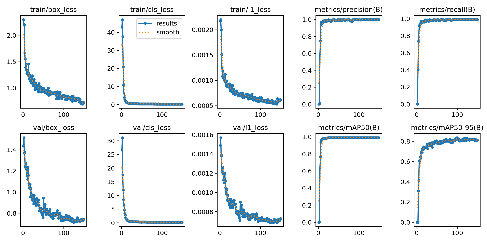
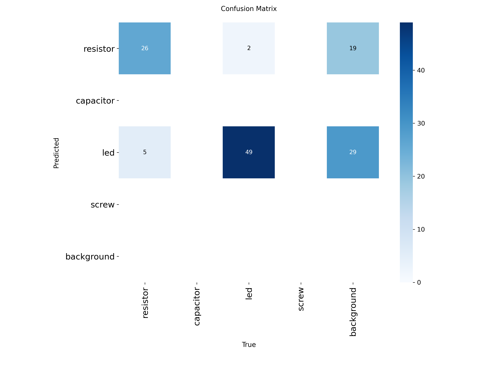

# 步骤 13 训练报告：零件检测模型（YOLO26n）与相机标定

模型训练了两版：第一版只有红色 LED；第二版加入多种颜色（含透明）的 LED，用来体现深度学习相对颜色规则的优势。仓库里的 `best.onnx` 是**第二版**。

## 1. 环境

| 项目 | 值 |
| --- | --- |
| 训练平台 | Google Colab（免费版），GPU NVIDIA Tesla T4（15 GB） |
| 软件（第二版） | ultralytics 8.4.178、Python 3.13.15、torch 2.11.0 + CUDA 13.0 |
| 软件（第一版） | ultralytics 8.4.176 |
| ONNX 导出与推理 | onnx、onnxruntime（对比数据用 CPU 版 onnxruntime，与网页 WASM 一致） |
| 标定 | 本地 Windows，Python + OpenCV（`tools/calibrate_camera.py`） |

## 2. 数据

- **场景**：零件放在打印的 A4 标定板（4 个 ArUco 码）上，iPhone 13 Pro 主摄 1× 拍摄，4032 × 3024，横拍竖拍都有，俯角与光照有变化。
- **类别**：本项目只用两类——色环电阻（`0 resistor`）和 LED（`2 led`，躺平放置，**不分颜色**）。类别表保持 4 类不变（电容 1、螺丝 3 没有样本），与网页 `src/config.js` 一致。
- **标注规则**：只框零件本体（电阻框色环段，LED 框灯体），不框引脚。夹爪只夹本体；引脚细且常弯，框进去会让框的大小忽大忽小。
- **标注方法**：
  - 第一版：`training/autolabel.py` 按颜色预标注（用 ArUco 码求标定板单应，在零件区域内按 HSV 分出红色灯体和蓝色电阻本体），再在 makesense.ai 中逐张检查修正。
  - 第二版新增照片：颜色规则找不到其他颜色的 LED、还会把蓝色 LED 当成电阻，改用第一版模型预标注（`predict_dump.py` → `detections_to_yolo.py`），再人工修正。
- **划分**（`split_dataset.py`，8 : 1 : 1，种子 42，按照片划分）：

| 集合 | 第二版照片 | resistor | led | 第一版照片 | resistor | led |
| --- | --- | --- | --- | --- | --- | --- |
| train | 122 | 241 | 379 | 84 | 162 | — |
| val | 15 | 27 | 54 | 10 | 20 | 23 |
| test | 15 | 28 | 43 | 10 | 20 | 25 |
| 合计 | 152 | 296 | 476 | 104 | 202 | — |

两版重新划分过，测试集不是同一批照片，指标不能逐项直接比较。

## 3. 训练

| 参数 | 值 |
| --- | --- |
| 预训练权重 | `yolo26n.pt`（COCO），两版都从它开始训练 |
| 输入尺寸 | 1024 |
| 轮数 | 150（全部跑完，未触发 patience = 50 的提前停止） |
| batch | 自动（`-1`，按显存选择） |
| 训练用时 | 第二版约 17.5 分钟（1053 s / 149 轮，T4）；第一版约 13 分钟 |
| 其他 | ultralytics 默认超参数与数据增强，种子 0 |

**收敛情况**（第二版 `results.csv`）：第 6 轮验证集 mAP50 达 0.94，第 11 轮 0.98；第 25 轮起 P ≥ 0.99、mAP50 ≈ 0.99；mAP50-95 最高 0.836（第 99 轮），最后约 0.81。验证集框损失从 1.4 降到约 0.73 后保持平稳，没有过拟合迹象。验证集召回率从第 72 轮起稳定在 0.991：54 个 LED 中始终有 1 个没检出（混淆矩阵里的"LED → 背景"），测试集上没有漏检。

## 4. 结果

**测试集**（训练时没见过的照片，`yolo detect val ... split=test imgsz=1024`，使用 `best.pt`）：

| 版本 | 类别 | 照片 | 框数 | P | R | mAP50 | mAP50-95 |
| --- | --- | --- | --- | --- | --- | --- | --- |
| 第二版 | all | 15 | 71 | 0.994 | 1.000 | 0.995 | 0.842 |
| 第二版 | resistor | 14 | 28 | 0.988 | 1.000 | 0.995 | 0.804 |
| 第二版 | led（多种颜色） | 15 | 43 | 0.999 | 1.000 | 0.995 | 0.881 |
| 第一版 | all | 10 | 45 | 0.995 | 1.000 | 0.995 | 0.869 |
| 第一版 | resistor | 10 | 20 | 0.997 | 1.000 | 0.995 | 0.788 |
| 第一版 | led（红色） | 10 | 25 | 0.993 | 1.000 | 0.995 | 0.951 |

**分析**：

- 第二版测试集 71 个零件全部检出（R = 1.0），P = 0.994，mAP50 = 0.995，达到任务书"mAP50 ≥ 0.9"的要求。
- **YOLO 相对颜色规则的优势**：颜色分割靠"红色 = LED、蓝色 = 电阻"，换成绿色、黄色、透明 LED 就找不到，蓝色 LED 还会被当成电阻；YOLO 学的是形状与外观，补充多种颜色的 LED 数据重新训练后，同一个模型在测试集上照样全部检出。
- LED 的 mAP50-95 从 0.951 降到 0.881：新加的 LED 颜色多、有透明的，边界更难框准；电阻从 0.788 升到 0.804，训练数据增加（162 → 241 个框）。
- 电阻的 mAP50-95 低于 LED：电阻本体在 1024 输入上只有约 20 × 8 像素，框偏 1–2 像素 IoU 就下降很多。按标定板上约 6.9 像素 / mm（原图）估算，这相当于不到 0.5 mm 的定位偏差，对夹取（电阻本体 Φ3 mm）没有影响。
- **重复框**：第二版验证集混淆矩阵（置信度阈值 0.25）里有 8 个"电阻→LED"、7 个"LED→电阻"、37 个"背景→电阻"、79 个"背景→LED"，但同一模型在验证集上 P ≈ 0.998、R ≈ 0.991、mAP50 = 0.99，说明这些主要是**低分的重复框**：同一个零件除了一个正确的高分框，还多出同类或**异类**的低分框（例如蓝色 LED 同时被框成 LED 和电阻）。第一版的 3 张对比照片里就有 2 张出现过同一零件被框两次（IoU 0.96–0.98，分数 0.57–0.75）。YOLO26 端到端（一对一）检测头本来不需要 NMS，但训练数据少，模型还没完全学会"一个物体只出一个框"。**步骤 14 网页推理时要加一步不分类别的去重**（两个框 IoU > 0.7 只保留分数高的），重复框分数可达 0.5–0.75，只调高置信度阈值不能可靠地去掉。
- 局限：数据只有 152 张、同一批零件、同一张标定板，验证集和测试集各 15 张，指标波动大；换背景、零件堆叠严重时的效果未验证；没有按 LED 颜色分别统计。

## 5. 导出

| 文件 | 说明 |
| --- | --- |
| `public/models/best.onnx` | 本项目模型（第二版，约 10 MB）；opset 18，端到端输出（`nms=False`），Colab 上由 `best.pt` 导出 |
| `public/models/best.json` | 类别、输入尺寸、输出格式（`export.py` 生成） |
| `public/models/yolo26n_coco.onnx` / `.json` | 官方 COCO 模型（10.2 MB，Colab 上导出），步骤 14 先用它打通网页推理 |

- 输入 `images: [1, 3, 1024, 1024]`，输出 `output0: [1, 300, 6]`，每行 `[x1, y1, x2, y2, 置信度, 类别]`，坐标在 1024 × 1024 输入图上。
- `public/samples/real/`：3 张第二版测试集照片（4032 × 3024）及其 ONNX 推理结果（`predict_dump.py --device cpu`，阈值 0.4，**未去重**），供步骤 14 与网页推理结果对比：网页先对比去重前的原始输出，再看去重后的结果。
- 第一版校验：在另一台机器（Linux、onnxruntime CPU）上用第一版 `best.onnx` 重跑对比照片，框坐标、置信度、类别与 Colab 结果逐位相同。

## 6. 相机标定

| 项目 | 值 |
| --- | --- |
| 棋盘格 | 9 × 6 内角点，方格 25.0 mm（`tools/chessboard_a4.pdf`，按实际大小打印，比例尺实测 100 mm） |
| 照片 | 26 张成功检测（iPhone 13 Pro 主摄 1×，HEIC；横拍方向 1 / 竖拍方向 6、8 混合） |
| RMS 重投影误差 | 1.319 px |
| fx / fy | 3060.4 / 3063.5 px（4032 × 3024） |
| cx / cy | 2002.6 / 1514.2 px（已按网页像素中心约定 +0.5） |
| 等效焦距 | 26.27 mm（主摄标称 26 mm） |

**分析**：fx 与 fy 相差 0.1%，等效焦距与标称值吻合，主点在画面中心附近。RMS 略高于 1 px 的经验目标；逐张误差分成两组，正拍的照片 0.4–0.9 px，斜拍和近拍的 1.3–1.8 px，推测原因是纸张不完全平整（正拍照片测得约 0.4 mm 起伏，斜拍时被放大）和每张照片自动对焦导致的焦距微小变化。1.3 px 约合标定板上 0.2 mm，对本项目的定位精度足够。网页目前只用 fx、fy、cx、cy，不用畸变系数。

标定过程中发现并修复了 `calibrate_camera.py` 的一个问题：原来只按宽高判断横竖，分不清横拿的两种方向（EXIF 1 / 3）和竖拿的两种方向（6 / 8），拿反的照片与其他照片差 180°。现在按 EXIF 方向把每张照片转回传感器方向；用已知内参渲染的合成照片验证，修复前主点偏差约 35 px，修复后 RMS 0.07 px、主点误差 < 0.5 px。
